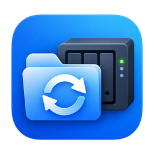

<p align="center"></p>

<h1 align="center">NALS</h1>
<p align="center"><strong>Native Application for Linux Sync</strong><br>Vaše soubory ze Synology NASu přímo v Linuxu.</p>

<p align="center">Fedora GNOME · Ubuntu · GTK4 / libadwaita · Čeština a angličtina</p>

NALS je nezávislá aplikace pro synchronizaci souborů mezi Linuxem a NASem Synology.
Vyberete složku na NASu, přiřadíte jí složku v počítači a synchronizace může
pokračovat na pozadí i po zavření okna. Stav ukazuje ikona v systémové liště.

Cílem je jednoduché ovládání, přirozený vzhled GNOME a opatrné zacházení s daty.
Aktuální verze **0.3.1 je experimentální**; není plnou náhradou Synology Drive Client.

## Co NALS umí

- **Procházení NASu a výběr složek** — po přihlášení nabídne dostupné sdílené složky.
- **Obousměrná synchronizace přes WebDAV** — zvolíte složku NASu, místní složku a použijete jediné tlačítko **Spustit synchronizaci**.
- **Obnovitelné změny a mazání** — společný stav umožňuje přenášet změny a smazání souborů. Předchozí obsah se archivuje a úprava má přednost před smazáním. Před spuštěním se ověřuje chování zámků na NASu.
- **Běh na pozadí** — samostatná služba provádí pravidelné kontroly; okno můžete zavřít.
- **Animovaná barevná stavová ikona** — při syncu se otáčejí oranžové šipky, v klidu je zelená, při pauze šedá a při chybě červená.
- **Automatická kontrola aktualizací** — kontroluje GitHub při spuštění a každých šest hodin; nabídne instalaci po potvrzení. Nativní balíky aktualizuje přes podepsaný systémový repozitář, až po zastavení syncu. Lokální vývojová instalace nabídne návod k přechodu na balíky.
- **Podrobný popisek ikony** — při najetí ukazuje aktuální činnost, počet souborů a přenesené MiB; umožňuje otevřít NALS či zastavit sync.
- **Volitelné zapamatování hesla** — používá systémovou klíčenku Secret Service / GNOME Keyring.
- **HTTPS a ověřování certifikátu** — podporuje i připojení přes místní IP při zachování názvu NASu v certifikátu.
- **Jednorázový ověřovací kód** — při přihlášení lze zadat OTP, pokud jej NAS vyžaduje.
- **České a anglické rozhraní** — aplikace respektuje jazyk systému nebo vlastní volbu.
- **Nativní instalace** — RPM pro Fedoru a DEB pro Ubuntu; při instalaci nepotřebujete Rust ani kompilátor.

## K čemu se hodí

Pro uživatele Fedory nebo Ubuntu, kteří chtějí mít vybranou složku ze Synology
NASu dostupnou také v počítači, průběžně přenášet nové soubory a sledovat stav
přenosů v prostředí GNOME. První verze je určená k opatrnému testování vybraných
složek, nikoli jako jediná záloha důležitých dat.

## Instalace

| Systém | Balík | Architektura |
| --- | --- | --- |
| Fedora 44 | RPM | x86_64 |
| Ubuntu 24.04 | DEB | amd64 |

Repozitář přidáte jednou. Potom aplikaci instalujete a aktualizujete běžným
správcem balíků. Podpisový klíč má otisk:
`BC63 3220 FF9A 33DE 7747 ED3F 63D7 0C9D 9A3D 640C`.

## Ubuntu 24.04 amd64 — jednorázové přidání

```sh
sudo install -d -m 0755 /etc/apt/keyrings
curl -fsSL https://imbecile6197.github.io/nals-packages/nals.asc | sudo tee /etc/apt/keyrings/nals.asc >/dev/null
echo 'deb [arch=amd64 signed-by=/etc/apt/keyrings/nals.asc] https://imbecile6197.github.io/nals-packages/apt stable main' | sudo tee /etc/apt/sources.list.d/nals.list
sudo apt update
sudo apt install nals
```

## Fedora 44 x86_64 — jednorázové přidání

```sh
sudo dnf config-manager addrepo --from-repofile=https://imbecile6197.github.io/nals-packages/nals.repo
sudo dnf install nals
```

Po přidání repozitáře stačí `sudo apt install nals` nebo `sudo dnf install nals`.
Samostatné balíky jsou také v [Releases](https://github.com/Imbecile6197/nals-packages/releases).

## První spuštění

1. Otevřete **NALS** z nabídky aplikací nebo spusťte `/usr/bin/nals`.
2. Zadejte HTTPS adresu NASu a přihlaste se svým účtem.
3. Vyberte složku na NASu a složku v počítači.
4. Na NASu zapněte HTTPS v aplikaci WebDAV Server (výchozí port **5006**) a povolte účtu přístup.
5. Uložte heslo do systémové klíčenky, uložte dvojici složek a klikněte na **Spustit synchronizaci**.

Tlačítko **O aplikaci** v záhlaví ukazuje verzi, licenci a informace o ochraně dat.

Pro stavovou ikonu potřebuje GNOME rozšíření podporující AppIndicator / KStatusNotifierItem.
Při instalaci se synchronizace automaticky nespouští.

## Jak pracuje se soubory

NALS používá **DSM / File Station API** pro procházení a stahování a **HTTPS WebDAV** pro zápis a archivaci. Neimplementuje proprietární synchronizační protokol Synology Drive.

Od verze **0.3.1** nabízí rozhraní jediný způsob spuštění: **Spustit synchronizaci**. Tři starší File Station varianty byly odstraněné z GUI. WebDAV používá obnovované serverové zámky, pracovní soubory, ověření SHA-256 a kontrolované zveřejnění cílového jména. Před spuštěním se ověří zámky i shoda složek mezi oběma rozhraními. Heslo zůstává v systémové klíčence a při běhu pouze v paměti služby.

Starý obsah se přesouvá do skrytých souborů `.nals-history-<UUID>`, trvale se nemaže. Úprava vítězí nad smazáním. Při souběžných úpravách se vybere novější obsah pouze při důvěryhodných časových údajích; nejisté konflikty zůstávají k rozhodnutí. Prázdné složky se neodstraňují a přejmenování se nesleduje jako samostatná operace.

Na DS223 prošel ve verzi 0.3.0 celý test služby v oddělené složce sdg-test: přenos oběma směry, náhrady, obnovitelné mazání i úprava proti smazání. Verze 0.3.1 upravuje rozhraní; synchronizační jádro nemění. **Úplný průchod velkou osobní složkou zatím potvrzený není. WebDAV zámky nechrání proti souběžným zápisům přes SMB, File Station nebo aplikace přímo na NASu.**

Limity jsou 100 000 položek, hloubka 32 a nejvýše 1 TiB na soubor. Přenosy používají průběžné čtení a dočasné soubory na disku.

## Přechod ze staré lokální instalace

Nejprve zastavte sync, zavřete NALS a zastavte staré uživatelské služby:

```sh
systemctl --user stop synology-drive-gnome-status.service synology-drive-gnome.service
```

Staré jednotky `~/.config/systemd/user/synology-drive-gnome.service` a
`~/.config/systemd/user/synology-drive-gnome-status.service` přejmenujte na `.backup`.
Stejně přejmenujte starý zástupce
`~/.local/share/applications/io.github.synology_drive_gnome.Prototype.desktop`.
Konfiguraci, klíčenku, synchronizované soubory a složku
`synology-drive-gnome.service.d` ponechte. Potom spusťte
`systemctl --user daemon-reload` a `/usr/bin/nals`.

## Co připravujeme

Dalším krokem je ověření úplného průchodu velkou osobní složkou, sledování
přejmenování a další práce se souběžnými změnami z jiných přístupových protokolů.

## Licence a zdrojový kód

Oficiální binární balíky jsou zdarma pro osobní i komerční používání podle
[NALS Binary Use License](LICENSE). Zdrojový kód aplikace zůstává soukromý.
Tento veřejný repozitář obsahuje distribuční konfiguraci, návody a balíky.
Použité knihovny si ponechávají vlastní licence; oznámení jsou součástí balíků.

## Chyby a návrhy

Pro hlášení použijte [Issues](https://github.com/Imbecile6197/nals-packages/issues).
Připište distribuci, verzi NALS a přesné chybové hlášení. Nepřikládejte hesla,
ověřovací kódy, identifikátory sezení ani snímky s citlivými údaji.

NALS je nezávislý projekt a není spojen se společností Synology ani projektem GNOME.
